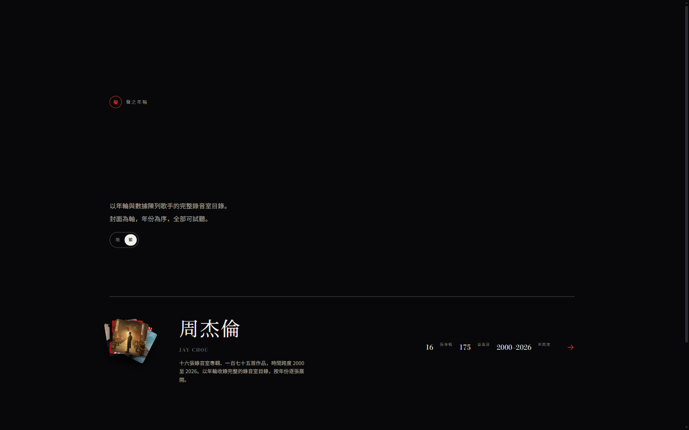
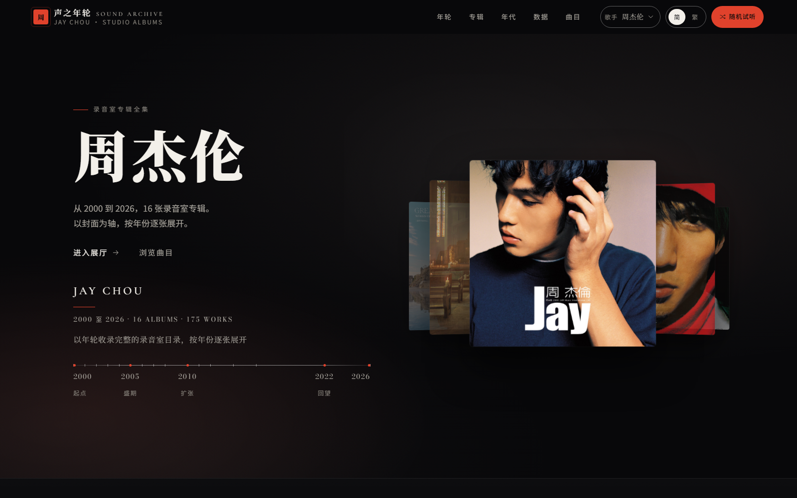
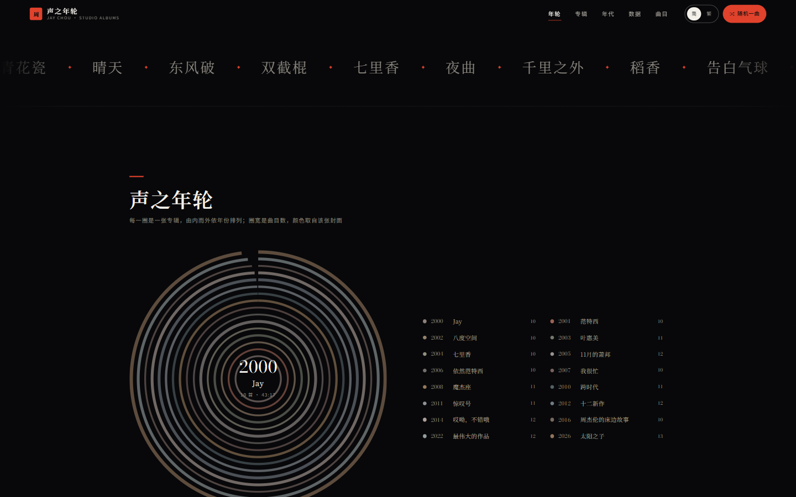
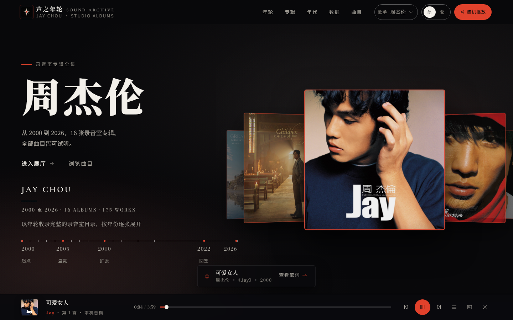
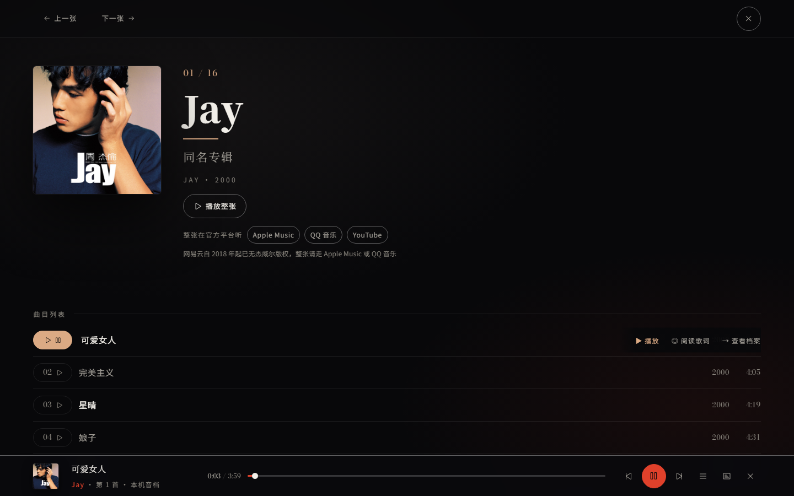
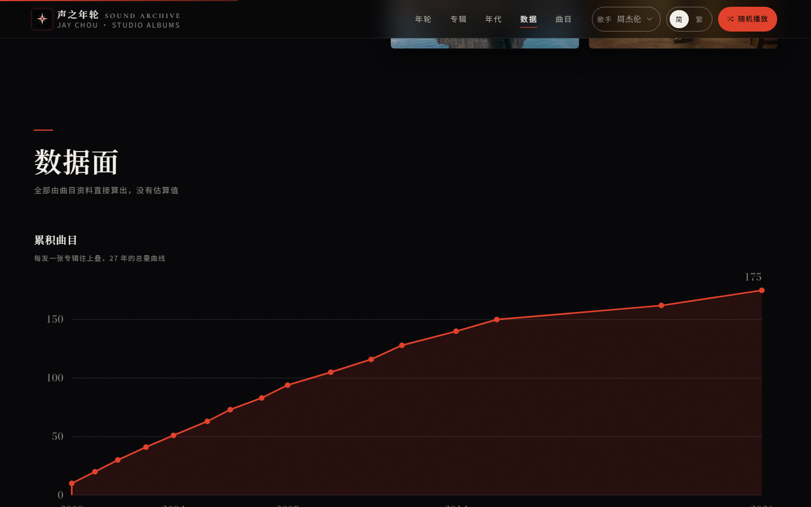
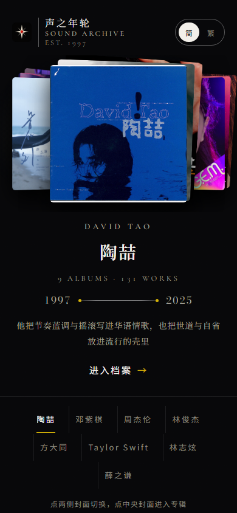
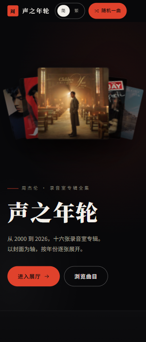

# 声之年轮

一套歌手唱片陳列模板：以年輪與數據陳列一位歌手的完整錄音室目錄。
現收錄**周杰倫**（16 張 / 175 首）、**Taylor Swift**（12 張 / 174 首）、**林志炫**（10 張 / 126 首）、**薛之謙**（13 張 / 131 首）、**林俊傑**、**方大同**、**鄧紫棋**。

每位歌手有自己的強調色與專屬母題，同一歌手的每張專輯抽屜也各有從封面派生的色彩。
零依賴、零建置、可離線。打開即選歌手，點進去是他的唱片年輪。

本倉託管於 GitHub（`discography-showcase`），push 後 CI 會自動跑一輪唯讀校驗。

---

## 能力

- **歌手選擇**：入口頁列出收錄的歌手，點進去是他的專屬陳列；新增歌手不需要改任何程式
- **歌手人格**：每位歌手有自己的強調色與專屬母題（追光 / 水墨 / 星夜 / 弧線 / 霓虹），主視覺就是歌手本名
- **專輯人格**：同一歌手的每張專輯，抽屜強調色都從那張封面派生，一張一個色彩世界
- **十四個展示面**：年輪、展櫃、年代分期、封面牆、數據面、長短篇、合作者、代表曲等，每面用不同佈局語言
- **年輪**：十六圈同心環依年份由內而外排列，圈寬對應曲目數，顏色取自該張封面平均色
- **試聽**：一千零三十九首全部可播官方 30 秒片段，底部播放列支援進度拖動、上下首、連續播放；
  放進自有音檔的曲目整首播放，播放列會如實標示當前是「本機音檔」還是「官方 30 秒試聽」
- **繁簡一鍵切換**：入口與歌手頁同步，全站文案與搜尋索引同時切換，選擇記憶在 localStorage
- **檢索**：一千零三十九首曲目總表，繁簡互通搜尋
- **全屏歌詞**：自有音檔配上同目錄 `.lrc` 即可開全屏歌詞舞台，逐行呈現、逐字掃光，
  支援 `Esc` 退出與減少動效降級
- **全屏專輯抽屜**：封面、發行資訊、編輯文字、完整曲目，支援前後翻專輯
- **無障礙**：全鍵盤可達、焦點環可見、抽屜焦點鎖定、減少動效降級、觸控目標 ≥ 44px
- **離線可用**：封面、字體、腳本全部本地託管，斷網仍完整呈現

## 预览

以下为实际渲染截图，非设计稿。

**入口 · 选歌手**



**歌手页主视觉**



**年轮 · 全站核心视觉**



**试听播放**



**专辑详情与逐行播放**



**数据面**



**移动端 · 入口**



**移动端 · 歌手页**



完整 19 张见 [screenshots/](screenshots/)。

## 快速开始

```
打開 index.html → 選一位歌手
```

本地伺服器（可選，供手機同網段訪問或自動化驗證）：

```powershell
node _data/serve.mjs 8099
# 開啟 http://127.0.0.1:8099
```

## 邊界與資料

- **倉庫不含任何完整錄音**，也不含來源不明的音訊
- 官方音源為 **Apple 隨目錄提供的 30 秒片段**，與中繼資料同一次請求返回
- 自有音檔只留在使用者本機，不進版本庫；播放時本機檔案優先，官方片段留作後備
- 專輯名、發行日、曲目、時長取自 **Apple Music / iTunes 公開目錄**（TW 店）
- Taylor's Version 重錄版非新專輯，不收錄；各歌手的精選與現場專輯不收錄（介紹中如實說明的混合型專輯除外）
- 簡介與年代分期文字為本站撰寫，非官方文案
- 封面圖像與錄音版權歸各自權利人所有；本站為個人非商業收藏陳列
- 字體為開源字體（Noto Serif SC / Noto Sans SC / Bodoni Moda，SIL OFL），已本地託管
- 頁面不含追蹤腳本、不含 Cookie、不發送任何資料到第三方；只有播放時才會連到 Apple 的 CDN

想放自己的音檔見下方。

## 想聽整首

站內每首的**官方音源**只放 **Apple 官方 30 秒試聽**，這是刻意保留的邊界：倉庫不含任何完整錄音。
要聽整首，走官方入口——會員權益無法接入第三方站，
非官方介面需服務端持有個人憑證，既有違服務條款又會暴露帳號。
評估過程見 [.agents/notes/網易雲接入可行性.md](.agents/notes/網易雲接入可行性.md)。

**若你自己擁有音檔**（自有 CD 抓軌、購買的 DRM-free 數位專輯），
把它們放進 `assets/audio/<專輯id>/`，跑一次工具即可整首、離線播放：

```powershell
node _data/local-audio.mjs --list-albums   # 查專輯 id
node _data/local-audio.mjs --write         # 掃描並登記，檔名可先不正規
npm run build:local                        # 本機檔案優先，官方試聽留作後備
```

工具會按檔名序號或曲名自動對應曲目，缺哪首、哪些檔對不上都會報出來。
`--write --rename` 可把檔名補正成「兩位數序號 + 描述」（保留原描述文字）。

音檔與登記檔**都不進版本庫**（見 [.gitignore](.gitignore)），
所以音檔只留在你本機；換一台機器或遠端部署時，播放會自動回退到官方試聽。

## 想加一位歌手

收錄一位新歌手不需要改任何程式，只要新增一個資料夾：

```
_data/artists/<歌手id>/
├── albums-raw.json   事實：發行日、曲目、時長、封面鍵、試聽網址
├── colors.json       事實：各封面平均色（由腳本生成）
└── meta.mjs          唯一手寫層：身份、每張專輯的介紹、代表曲、年代分期、主題
```

抓取與生成都有現成腳本，完整六步見
[_data/artists/README.md](_data/artists/README.md)：

```powershell
node _data/fetch-artist.mjs --list  --itunes-id <歌手id> --country tw
node _data/fetch-artist.mjs --fetch --itunes-id <歌手id> --artist <歌手id> --keys "<collectionId=鍵, ...>"
powershell -File _data/make-responsive-covers.ps1
powershell -File _data/extract-colors.ps1 -Artist <歌手id>
# 然後手寫 meta.mjs，最後：
npm run build
```

建置後入口頁會多出一行，歌手頁的主題（強調色、印章、題名、母題）全由
`meta.mjs` 的 `theme` 驅動；`build.mjs` 不必改動。

## 授權

**本站原創程式碼**以 MIT 授權，全文見 [LICENSE](LICENSE)。
以下內容不在該授權範圍內，權利屬各自權利人：

- **封面圖像**：專輯封面版權歸各唱片公司與創作者，本站僅為個人非商業收藏陳列而收錄，
  未取得再授權；要轉載請自行取得授權
- **字體**：Noto Serif SC、Noto Sans SC、Bodoni Moda，SIL OFL 1.1，
  許可證全文見 [assets/fonts/licenses/](assets/fonts/licenses/)
- **事實資料**：`js/data.js` 的專輯與曲目名稱、時長、發行日取自 Apple Music / iTunes 公開目錄
- **錄音**：本倉不含任何完整錄音；自有音檔只留在使用者本機，不進版本庫

想為其他歌手做同類陳列：資料管線可直接復用，素材請使用你自己取得授權的。

## 貢獻

個人專案，不接受外部貢獻。若你要照著改一份自己的，請先讀
[AGENTS.md](AGENTS.md) 的全局規則，那裡列了不可破壞的約束。

維護者文件地圖見 [AGENTS.md](AGENTS.md)。
