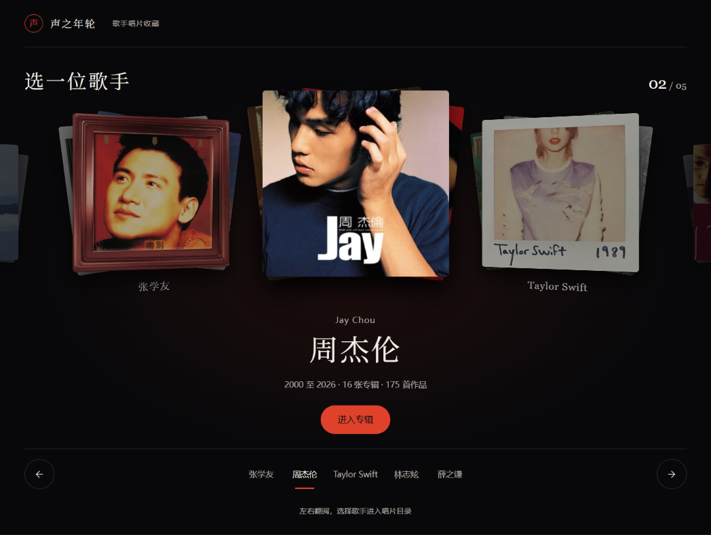
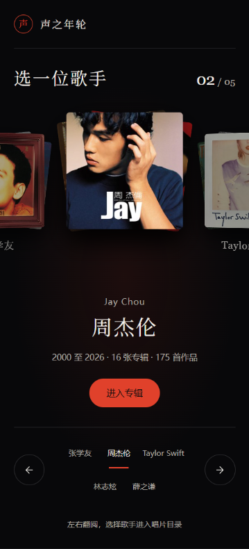

# 歌手入口立體唱片架實作計畫

狀態：2026-10-12 已確認設計方向，待執行 agent 實作與驗收。
使用者選定「立體唱片架」：首頁以中央歌手為焦點，左右翻閱其他歌手。
本文件是此項工作的執行依據；總待辦見 [PLAN.md](PLAN.md#後續待辦首頁立體唱片架)，全局約束見 [AGENTS.md](../AGENTS.md)。

## 已確認的範圍

- 首頁 `index.html` 的五行歌手索引由立體唱片架取代，資料與人數仍完全由 `DISCOGRAPHY.order` 決定。
- 保留深墨底、紙白文字、襯線標題、封面與細分隔線；歌手色只點綴選中狀態、印章、按鈕與低強度光暈。
- 中央顯示當前歌手的封面組，兩側露出相鄰歌手；下方同步顯示姓名、英文名、年代、專輯數、曲目數及「進入專輯」。
- 支援左右箭頭、左右拖曳或滑動、歌手姓名直接選擇，以及鍵盤操作；由使用者控制切換。
- 「橫向畫冊」是評審時的比較稿，本次實作唯一目標為「立體唱片架」。
- 沿用零執行期依賴、本地封面與字體、繁體原文與簡體預設，以及 `file://` 可用的要求。
- 工作集中在首頁；保留其他 agent 已完成的標題可見、小字下限、開場與歌手頁 UI 修復。
- 原先「桌面首屏露出兩位歌手、手機四位」的列表驗收，由本文件的唱片架首屏要求接替。

## 視覺參考

下圖是已確認方向的概念參考，並非目前站點的驗收截圖。
以封面層次、中央焦點、資訊位置與控制項結構為準，實作尺寸按下方首屏標準收斂。
參考圖中的周杰倫只是展示狀態，正式預設選擇按資料順序與狀態規則處理。

## 版面與尺寸

| 區域 | 桌面 | 手機與窄屏 |
|---|---|---|
| 品牌列 | 左側印章與「聲之年輪」，簡繁切換靠右 | 品牌與簡繁均保留，控制項不得超出畫面 |
| 頁面標題 | 「選一位歌手」，右側顯示當前序號與總人數 | 標題與序號可同行；序號隨資料人數生成 |
| 封面舞台 | 中央一組最大，左右各露出一組，遠端可淡出或裁在舞台內 | 中央組約佔可用寬度 55% 至 65%，兩側各露出一小段 |
| 歌手資訊 | 中央對齊，姓名最醒目，英文名次之，統計一行 | Taylor Swift 等較長姓名完整顯示，統計可自然換行 |
| 主操作 | 明確的「進入專輯」連結 | 首屏可達，觸控區至少 44px |
| 切換列 | 左右箭頭分列兩端，中間是全部歌手姓名 | 姓名容許兩至三行排版，維持全部可達；箭頭不覆蓋姓名 |
| 次要說明 | 收錄、試聽、離線與權利說明位於主操作之後 | 自然向下排，空間不足時允許縱向捲動 |

- 舞台居中，沿用 `--page` 與 `--gutter`；不要另造一套全站尺寸權杖。
- 桌面中央封面建議從 260px 至 340px 調整，每位歌手以最多三張封面形成一組淺扇形。
- 相鄰組縮放約 0.80 至 0.86，側轉約 18 至 26 度；降低的是封面存在感，操作文字仍須清楚。
- 封面固定正方形，明確設定寬高或 `aspect-ratio` 與對應高度，避免圖片屬性令縮放後的封面拉長。
- 圓角只用 `--r` 與 `--r-pill`；字體沿用 `--f-serif`、`--f-sans`、`--f-num`，小字不低於 12px。
- 在 1366×768、1440×900 與 390×844 下，品牌、標題、中央封面、當前資訊、主操作與切換列應在首屏可用。
- 320px 或低高度視窗允許縱向捲動；不要以固定高度裁掉操作，也不要讓整頁出現橫向捲軸。

## 資料與狀態

| 內容 | 唯一來源或規則 |
|---|---|
| 歌手清單及順序 | `window.DISCOGRAPHY.order`，不得另寫五位歌手陣列 |
| 姓名與英文名 | `artists[id].name`、`.en`；兩者相同時省略重複英文行 |
| 封面組 | `artists[id].covers` 前三張，沿原順序；第一張在最前方 |
| 年代、專輯與曲目數 | `.stats.from`、`.stats.to`、`.stats.albums`、`.stats.tracks` |
| 歌手點綴色 | `.theme.accent` 與 `.theme.accentOn`，覆蓋限於入口所需範圍 |
| 進入連結 | `artist.html?a=` 加 `encodeURIComponent(id)`，使用真實 `<a href>` |
| 語言 | 延續 `jc-lang` 與 `DISCOGRAPHY.toSimplified`，預設簡體 |
| 首次選擇 | `D.order[0]`；不因參考圖而寫死周杰倫 |
| 返回與重新整理 | 以 sessionStorage 的 `discography-selected-artist` 記住本分頁最後選擇的有效 id |

- 儲存被封鎖、記錄過期或 id 已移除時回退到首位，不阻止瀏覽。
- 畫面、姓名列選中態、主連結、序號與輔助技術通知必須由同一個當前 id 更新。
- 動態姓名、統計與 `aria-label` 使用繁體原文再轉換；處理 `landing.js` 的 WeakMap 原文快取，避免切換歌手後又切語言時還原成上一位歌手。
- 不從 `intro` 解析統計，不手改 `js/data.js`，也不為此新增資料契約或重寫構建管線。
- 0 位歌手顯示可讀空狀態並隱藏切換操作；1 位停用左右切換；2 位與更多歌手仍按相同規則工作。
- 封面少於三張時使用實際數量；單張失敗時提供簡單佔位，姓名與進入連結仍可用。

## 操作規則

| 操作 | 必須得到的結果 |
|---|---|
| 點左右箭頭 | 切換上一位或下一位；首尾循環 |
| 點舞台上的歌手封面組 | 選中該歌手，保持在首頁；不把選擇操作與進入歌手頁混在一起 |
| 點歌手姓名 | 直接選中對應歌手，更新同一組狀態 |
| 點「進入專輯」 | 導向選中歌手的既有頁面；Ctrl／Cmd 點擊與另開分頁正常 |
| 控制區內按左右方向鍵 | 切換歌手；Home／End 選第一位／最後一位 |
| Tab 與 Enter／Space | 原生按鈕與連結可逐一操作，焦點清晰且不因切換重建而丟失 |
| 水平拖曳或滑動 | 一次手勢切換一位；距離至少約 40px，且水平位移大於垂直位移的 1.3 倍 |
| 垂直滑動與滾輪 | 保持頁面原生捲動；不以滾輪強制翻頁 |
| 快速連點或中途反向 | 立即接受最新選擇，過渡接續到最新位置，姓名、封面與連結不脫節 |

- 使用 pointer events，處理 `pointercancel` 與拖曳後的 click 抑制，避免一次手勢又誤選其他封面。
- 封面圖設為不可原生拖曳；垂直捲動保留 `touch-action: pan-y`。
- 循環位置按當前總人數計算，不以複製整套可互動 DOM 實現首尾銜接。
- 鍵盤事件限於唱片架相關控制區，不在整個 document 攔截方向鍵。
- 使用語意按鈕、真實連結、可讀名稱與 `aria-pressed`；選擇變化以 `aria-live="polite"` 簡短通知。
- 純裝飾封面疊放不重複朗讀；舞台外被完全裁掉的組不得留下不可見焦點，姓名列仍提供全部歌手入口。
- 所有觸控目標至少 44×44px；不能只靠 hover 才能辨認或操作。

## 動效與效能

- 切換以 `transform` 與 `opacity` 為主，建議從 550ms 至 650ms 的柔和減速過渡調整。
- 按鈕與選中標記的回饋約 160ms 至 200ms，不套用唱片移動時長或錯峰延遲。
- `prefers-reduced-motion` 下立即完成位置切換，取消動畫與側轉，所有選擇入口繼續可用。
- 沿用基礎態可見的標題修復；不等待開場完成才允許選歌手或進入專輯。
- 不自動輪播、不自動試聽、不加入背景持續循環、全屏 blend 顆粒或反光鏡面。
- 指標高頻事件使用 rAF 節流；尺寸只在初始化與 resize 等時機量測，不在每次移動時交錯讀寫版面。
- 圖片使用已有相對路徑與響應式資產；當前組優先，其他組可延後載入，全部預留正方形空間。
- 概念圖只是視覺依據；正式頁不引入對話預覽的 variant carousel、Tweak、host API、base64 圖片或外部 CDN。

## 修改檔案與執行順序

| 檔案 | 本項職責 |
|---|---|
| `index.html` | 首頁品牌列、舞台、當前資訊、主連結、切換列與可讀空狀態 |
| `js/landing.js` | 從資料產生歌手組、統一選擇狀態、綁定輸入、會話記憶與繁簡更新 |
| `css/style.css` | 在入口頁分節整理樣式，使用入口專屬鉤子；補響應式與減少動效規則 |
| `css/README.md`、`js/README.md` | 完成後同步入口樣式與腳本職責、檢查路由 |
| `docs/ARCHITECTURE.md` | 完成後記錄入口的選擇、狀態與導覽決策 |
| `AGENTS.md`、`docs/PLAN.md` | 驗收後更新舊入口快照、勾選待辦與後續入口 |

1. 先讀根、`css/`、`js/` 的 AGENTS 與 README，再讀本文件及兩張參考圖。
2. 檢查當前工作區與既有入口修復；由一位執行 agent 統籌三個入口實作檔，避免和其他 UI 工作同時覆寫。
3. 先完成資料驅動的靜態舞台、姓名選擇、當前資訊與主連結，驗證選擇和導覽。
4. 再加入循環切換、拖曳、鍵盤、狀態記憶、動效與降級，逐項跑下方驗收。
5. 最後同步文檔、保留正式頁的桌面與手機截圖，再勾選待辦；概念圖不得充當實作驗收圖。

## 驗收清單

- [ ] 首頁符合中央大封面、兩側相鄰封面、下方歌手資訊與全名選擇列的已確認構圖。
- [ ] 五位歌手逐一選擇，圖片無破損；姓名、統計、序號、色彩與 `href` 始終對應同一位歌手。
- [ ] 滑動、拖曳、箭頭、姓名直選、方向鍵、Home／End、Tab、Enter／Space 均按規則工作。
- [ ] 第一位向前、最後一位向後、快速連點與動畫中反向操作均無跳錯、空白或失焦。
- [ ] 簡體切繁體、切歌手再切回簡體後內容正確；返回首頁或重新整理恢復有效選擇，禁用儲存時仍可使用。
- [ ] 在 1366×768、1440×900、390×844 檢查首屏要素；在 320px、380px 與低高度視窗檢查自然換行、目標尺寸及縱向可達。
- [ ] 整頁沒有橫向溢出，左右預告只在舞台內裁切；Taylor Swift 全名及所有姓名按鈕可讀可達。
- [ ] 檢查正常動效與減少動效、正文 4.5:1 對比、控制邊界 3:1 對比、焦點可見與選擇通知。
- [ ] 以瀏覽器記憶體中的臨時 fixture 驗 0、1、2、6 位歌手及缺封面情況，驗後恢復；不修改生成資料來湊用例。
- [ ] `http://` 與 `file://` 均完成入口 → 五位歌手 → 專輯 → 試聽；斷網仍可讀取本地封面與字體。
- [ ] 確認入口專屬 CSS 沒有破壞歌手頁標題、sticky 展櫃、抽屜或播放器，控制台無新增錯誤。
- [ ] 執行 `npm run lint`、站點 E2E、`npm run check:docs`、`npm run check:eol`；有根設定變更才依規則加跑全套 `npm run check`。

自動化量測樣式前先將頁面置前；固定與 sticky 圖層的截圖限制依根 AGENTS 的活躍坑處理。
交付時報告修改檔案、檢查結果、正式頁桌面／手機截圖，以及仍未通過的項目。
